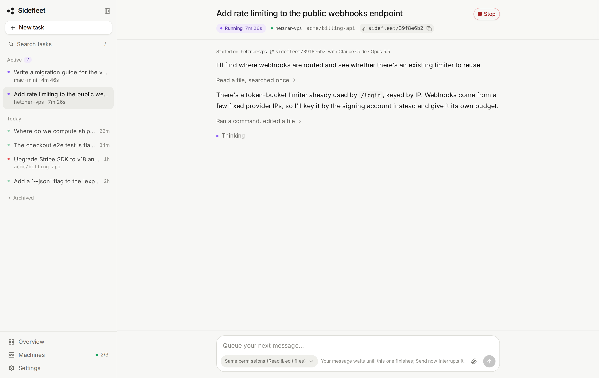
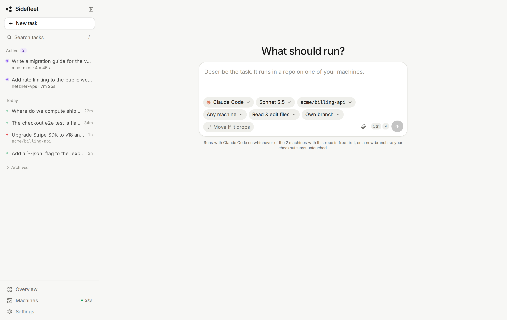
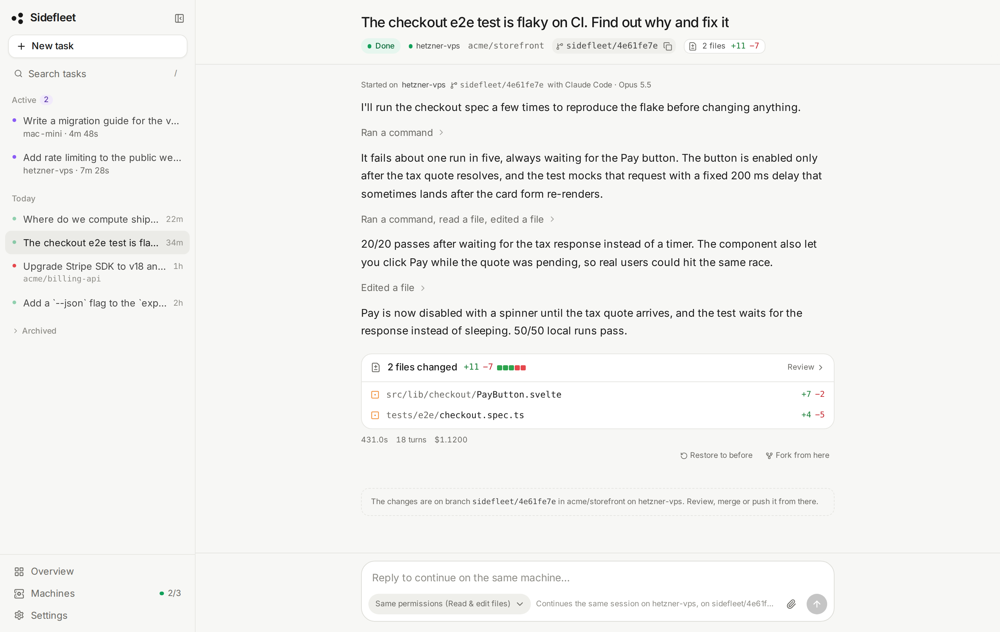
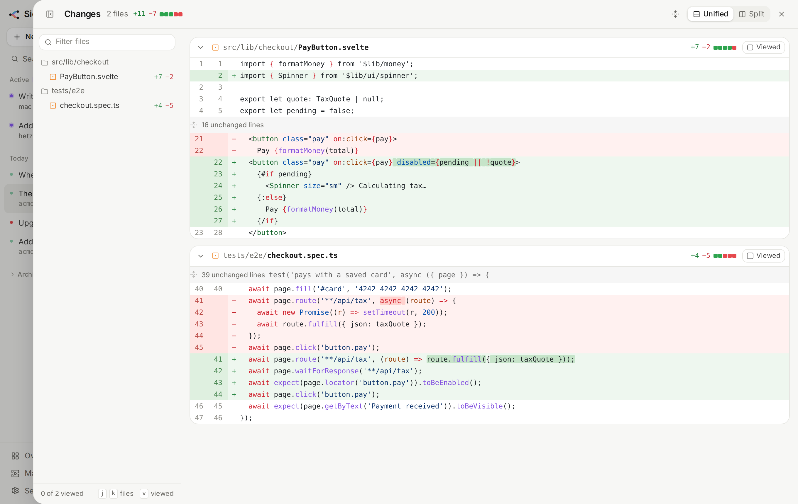
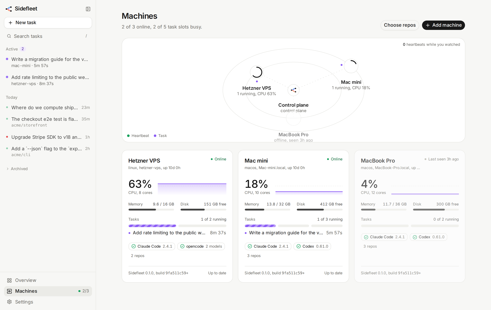

# Sidefleet

**Run coding agents on your own machines, from anywhere.**

[Website](https://www.sidefleet.xyz) · [Install](#install) · [Quick start](#quick-start) · [API](docs/API.md)

> [!NOTE]
> Sidefleet is under active development: expect rough edges, and things may change between
> versions.

Type a task on a web page, pick an agent, a model and a repo, and a machine you own picks it up:
your desk Mac, a Mac mini, a VPS. It runs Claude Code, Codex or opencode in its own git worktree
and streams the agent's narration back live; reply to keep the conversation going. No API keys for
Claude or Codex: it uses the login already on that machine. opencode brings any other model
(Kimi, GLM, DeepSeek, Qwen through OpenRouter, or local ones). No open ports: machines only make
outbound calls to your control plane. One Rust binary, macOS and Linux.



```
 browser ──HTTP/SSE──▶ sidefleet serve   (control plane: web page + API + Postgres)
                              ▲
                              │ outbound HTTP only (register, heartbeat, claim, events)
                              │
                       sidefleet run ──spawns──▶ claude -p / codex exec --json / opencode run --format json
                       (worker on your Mac, VPS, Linux box: cwd = the repo)
```

## Features

- **Bring your agent**: Claude Code, Codex or opencode, chosen per task. Each one runs as its own
  CLI with its own sign-in, and its output is mapped to the same live view. Tasks only go to
  machines that have the chosen agent.
- **Your machines, one page**: every connected machine with its repos, agents, CPU and running
  tasks on a live fleet map. Tasks go to the least busy machine that has the repo and agent, or
  pin one to a machine. Machines can be signed in to different accounts: when one hits its usage
  limit, its task moves to another machine and the page shows "usage limit until 14:00".
- **Isolated by default**: each task gets its own git worktree and branch (`sidefleet/<id>`), so
  several tasks on one repo run side by side without touching your checkout. Choose "In place"
  when a task needs installed dependencies or local config.
- **Survives a machine dropping** (opt-in per task): with "Move if it drops", the worker commits
  and pushes the task's branch to the repo's `origin` at most once a minute while the agent edits.
  If the machine stops responding (a laptop going to sleep), the task moves to another machine with
  the repo and continues from the last pushed commit, with a digest of the thread so far. Off by
  default, because it pushes; only the task's own `sidefleet/...` branch is ever pushed.
- **Restore**: every message's files are snapshotted before and after it, so "Restore to before"
  puts the worktree back to how it was before any message. The conversation carries on, and a
  restore can itself be undone.
- **Fork**: start a new thread from any message, with any agent and model (say, a Claude Code
  thread continued in Codex). The new thread starts on its own branch with the files as they were
  after that message, and its agent gets the conversation up to there as a transcript.
- **Live, and a conversation**: events stream over SSE within milliseconds, survive reloads and
  dropped connections, and replies resume the same agent session like a chat. Reply while it works
  and the message waits its turn, or press Send now to interrupt. Screenshots and other images the
  agent opens show inline, so you can ask for one from your phone. Drop, paste or attach images to a
  task or reply and the agent gets them too.
- **Waiting on you**: a bell lists every task that needs you, with why and for how long: finished
  and waiting for a reply, failed, paused on a usage limit, or its machine dropped. Each such task
  also gets a marker in the sidebar. A task leaves the list when you open it, reply or dismiss it,
  and what you have seen is kept on the control plane, so it is the same on your phone and laptop.
  Turn on "Notify me" for a push notification when a task starts waiting; it carries only the
  task's title and the reason, never agent output. Browsers only allow push on HTTPS pages or
  `localhost` (on iPhone, add the page to the Home Screen first). `serve` creates the VAPID key for
  it in `~/.sidefleet/server.env`; elsewhere set `SIDEFLEET_VAPID_PRIVATE_KEY`.
- **Permission modes**: read and edit files (default), full access for unattended commands, or
  read only for questions.
- **Zero-config workers**: `connect` checks which agents are installed and signed in, finds your
  git checkouts (repos match by their git remote, whatever the folder is called), and installs a
  launchd or systemd service that survives reboots. Or click "Copy prompt" and let Claude Code or
  Codex on the other machine connect itself.
- **Secrets stay put**: anything that looks like a credential is redacted on the worker and again
  on the control plane; tokens are stored as SHA-256 digests and never logged.






## Install

```bash
curl -fsSL https://raw.githubusercontent.com/foodaka/side-fleet/main/install.sh | sh
```

Downloads a prebuilt `sidefleet` into `~/.local/bin` (no sudo), or builds from source when there
is no release for your platform.

<details>
<summary>Private repo? Install with the GitHub CLI or from a clone</summary>

While the repository is private, the raw URL returns 404. Use the GitHub CLI (`gh auth login`),
which the script then uses for the download:

```bash
gh api repos/foodaka/side-fleet/contents/install.sh -H "Accept: application/vnd.github.raw" | sh
```

Or clone over SSH and build from the checkout, never contacting GitHub:

```bash
git clone git@github.com:foodaka/side-fleet.git && sh side-fleet/install.sh
```

</details>

## Quick start

**1. Start the control plane** on the machine that will host the page. It needs Postgres:

```bash
docker run -d --name sidefleet-db --restart unless-stopped \
  -e POSTGRES_USER=sidefleet -e POSTGRES_PASSWORD=sidefleet -e POSTGRES_DB=sidefleet \
  -p 5432:5432 -v sidefleet-pgdata:/var/lib/postgresql/data postgres:16-alpine
sidefleet serve
```

```
Sidefleet control plane is running.

  Open the page:        http://<this-machine>:7373/
  Developer key:        3f9c…
  Connect a machine:    sidefleet connect --control http://<this-machine>:7373 --token 7b2e…
```

Keys are saved to `~/.sidefleet/server.env`. If the machine has a coding agent installed, `serve`
runs a worker on it too, so a single box is one command.

**2. Open the page** and paste the developer key.

**3. Connect more machines.** On any machine with an agent set up (see [Agents](#agents)), run the
install line, then the connect line the page shows you. The page switches to the compose box as soon as the first
heartbeat lands.

Across networks, put the control plane on [Tailscale](https://tailscale.com) and use its tailnet
IP: no port forwarding, no public exposure. Running it on a VPS or a spare machine is covered in
[HOSTING.md](HOSTING.md).

**No token at hand?** `sidefleet connect --control <url>` without `--token` asks the control plane
to let the machine in: it prints a link and a short code, and the machine joins once someone
approves it under Pending machines on the Machines page (the request expires after ten minutes).

**Hosted, multi-tenant mode.** Setting `SIDEFLEET_GITHUB_CLIENT_ID`,
`SIDEFLEET_GITHUB_CLIENT_SECRET` and `SIDEFLEET_PUBLIC_URL` turns on GitHub sign-in, orgs, per-org
worker tokens and plan limits. What it stores and how to deploy or try it locally:
[HOSTED.md](HOSTED.md).

## Agents

| Agent | Set it up on the machine | Models |
|---|---|---|
| Claude Code | `claude`, sign in once | Opus, Sonnet, Haiku |
| Codex | `codex login` (ChatGPT sign-in or API key) | what `codex debug models` lists for the account, or its default |
| opencode | `opencode auth login`, e.g. OpenRouter; or add `OPENROUTER_API_KEY=…` to `~/.sidefleet/worker.env` | any `provider/model` it lists, e.g. `openrouter/moonshotai/kimi-k2` |

`sidefleet connect` reports which agents it found and whether they are signed in, and the Machines
page shows the same. Local models (Ollama, LM Studio) run through opencode once you add them as an
opencode provider.

The page's permission modes map onto each agent:

| Mode | Claude Code | Codex | opencode |
|---|---|---|---|
| Read & edit files | `acceptEdits` | sandbox `workspace-write` (commands run sandboxed, no network) | shell denied |
| Full access | `bypassPermissions` | no sandbox | all permissions granted |
| Read only | `plan` | sandbox `read-only` | `plan` agent, edits, shell and fetches denied |

## Command line

```sh
sidefleet serve                       # control plane on :7373, plus a local worker
sidefleet serve --no-worker           # control plane only
sidefleet serve --install-service     # run serve as a background service
sidefleet connect --control <url> --token <t>   # register this machine, install the service
sidefleet connect --control <url>     # no token: wait for approval on the Machines page
sidefleet connect … --name "Mac mini" --parallel 3 --permission-mode bypassPermissions
sidefleet status                      # saved settings, service and process state, log path
sidefleet disconnect                  # remove the service (settings kept)
sidefleet run                         # worker in the foreground with the saved settings
sidefleet detect                      # what this machine can run, as JSON
sidefleet update                      # pull the latest, reinstall, restart services
```

Every flag can also come from the environment (`SIDEFLEET_BIND`, `DATABASE_URL`,
`SIDEFLEET_DEV_KEY`, `SIDEFLEET_WORKER_TOKENS`, …), a `.env` in the current directory, or
`~/.sidefleet/server.env` / `worker.env`. `sidefleet <command> --help` lists them all. Worker logs
are in `~/.sidefleet/logs/`.

The HTTP API and the lifecycle of a run are documented in [docs/API.md](docs/API.md).

## Develop

```bash
docker compose up -d --wait      # Postgres for local runs and tests
cargo test --workspace           # integration tests create and drop sidefleet_test_* databases
cargo run -p sidefleet -- serve
```

The web UI's build output in `crates/server/web-dist/` is committed so Rust-only installs keep
working; run `pnpm build` in `web/` after changing it (CI fails if it is out of date). Tagging
`vX.Y.Z` builds release binaries for macOS (arm64, x86_64) and Linux (x86_64, arm64).

## Layout

- `crates/core`: shared models, the agents and the mapping of each one's output to events, redaction.
- `crates/server`: Axum control plane, Postgres via sqlx migrations; embeds the web app.
- `crates/worker`: machine detection, control-plane client, process-group executor, worker loop.
- `crates/cli`: the `sidefleet` binary.
- `web/`: the web UI, SvelteKit + shadcn-svelte. See [web/README.md](web/README.md).
- `site/`: the website at [www.sidefleet.xyz](https://www.sidefleet.xyz), one static page. See
  [site/README.md](site/README.md).

## Known limitations

- **This drives your own agent sign-ins, headless** (Claude, ChatGPT, or the API keys opencode
  uses). Usage counts against those accounts' plans or bills. Check the terms that apply to your
  subscriptions for automated or unattended use, and never share or resell access to an account
  through it.
- Self-hosted, there is a single shared developer key and no TLS of its own. Keep that control
  plane on a private network (LAN or Tailscale), or run the hosted mode behind TLS
  ([HOSTED.md](HOSTED.md)).
- The control plane runs as one process: live events fan out in memory, so it does not scale out
  to several instances yet.
- A thread keeps the agent it started with; to switch, fork it. A fork's agent gets a transcript
  of the messages, replies and tool calls (the newest 32 KB), not the original session, so it
  doesn't see tool output or the agent's thinking.
- A fork that starts from a message's files runs on the machine that has them, so the agent you
  pick must be installed there.
- Restoring puts back the files, not the conversation: the agent still remembers what it did.
  Only tasks in their own worktree can be restored. Snapshots are kept as git refs under
  `refs/sidefleet/snapshots/` (remove with
  `git for-each-ref --format='delete %(refname)' refs/sidefleet/ | git update-ref --stdin`).
- Codex's sandbox only writes inside the worktree, and a worktree's git data lives in the main
  checkout, so `git commit` by Codex can fail under "Read & edit files". Commit from the branch
  afterwards, or use Full access.
- opencode's output format was mapped from its source (1.19), not yet from a live run; its cost is
  what opencode reports per step.
- Tool permission prompts are not relayed to the page; whatever the mode does not allow is denied.
- Worktrees start from the repo's `HEAD` without untracked or ignored files (`node_modules`,
  `.env`), and are kept until you remove them (`git worktree remove`, or delete the folder under
  `~/.sidefleet/worktrees` and run `git worktree prune`).
- A follow-up runs only on the machine that holds the session, and waits while it is offline.
- Redaction is pattern-based: a safety net, not a guarantee.
- Windows is not supported.

License: MIT.
